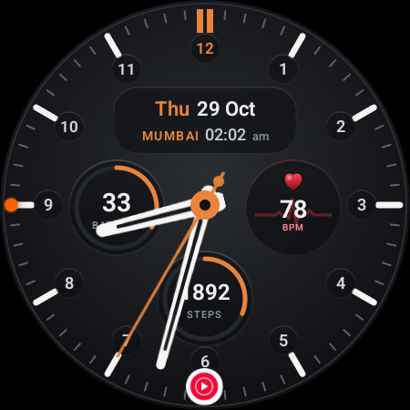
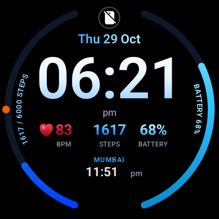
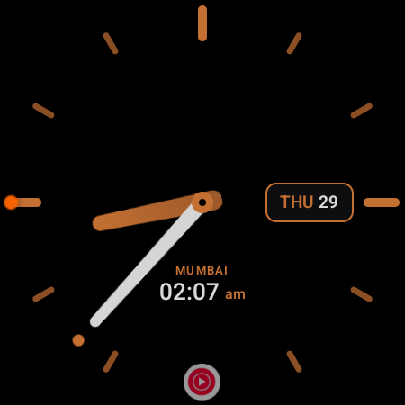

 
 


<p align="center">
  <picture>
    <source media="(prefers-color-scheme: dark)" srcset="images/hero-dark.svg" />
    
  </picture>
</p>

# Galaxy Watch 4, tuned up with Claude Code

My Galaxy Watch 4 is five years old and out of software support. It still worked, but it felt tired: swipes lagged and the battery drained faster than it should.

My motive for this project was to see how far I could get **without rooting** it, using Claude Code on my Mac talking to the watch over wireless adb. I set four rules before we started:

1. **No root.**
2. **Nothing permanent.** Apps are only disabled, never uninstalled.
3. **Ask me before every change** on the watch.
4. **Log every command with its undo.** The changelog ended at 35 entries.

Along the way we also built two custom watch faces and moved the always-on display to the watch's low-power chip, which turned out to be the most fun part.

📣 **LinkedIn post (with a 30 s video):** [I let Claude tune my old smartwatch](https://www.linkedin.com/feed/update/urn:li:activity:7523319320005722112/)

## What changed (measured, not guessed)

| | Before | After |
|---|---|---|
| Google Assistant CPU while idle | ~21% (listening for "Hey Google") | gone |
| Free memory | ~225 MB | ~345 MB right after the clean-up |
| Swap in use | ~685 MB | ~323 MB |
| Uptime | 32 days without a restart | weekly restart routine |
| Always-on display | drawn by the main CPU, hand-off retried every ~8 s | `OFFLOADED` to the low-power chip |

**Honest caveat:** free memory drifts back towards ~230 MB after a day of use. The lasting wins are smaller but real: the Assistant's idle CPU is gone, a dozen fewer apps run in the background, and a weekly restart keeps it fresh.

## The guide

Every step is written down, including what didn't work.

[Part 1](docs/Part1-Connect-over-Wireless-adb.md): Connecting a Mac to the watch over wireless adb (and the gotchas that cost me an hour)

[Part 2](docs/Part2-Measure-Before-You-Change.md): Measuring first: memory, CPU per process, swap, wake-ups, frame times

[Part 3](docs/Part3-Speed-It-Up-Safely.md): Speeding it up safely: every command with its undo

[Part 4](docs/Part4-Build-a-Watch-Face.md): Building watch faces in Watch Face Format (XML, no code), validating and installing them

[Part 5](docs/Part5-AOD-on-the-Low-Power-Chip.md): The detective story: getting the always-on display onto the low-power chip

Also: [Do's and Don'ts](docs/Dos-and-Donts.md) · [Questions & Answers](docs/Questions-and-Answers.md) · [Troubleshooting](docs/Troubleshooting.md)

## Looks like this

<p align="center">
  
  
  
</p>

- **Heritage Clean** (analog): charcoal dial, accent themes (orange, blue, silver, metallic black), glass sub-dials for battery, heart rate and steps, a date pill with a second time zone, and a heartbeat animation you can switch off.
- **Blue Rings** (digital): bold time, gradient rings for steps and battery, curved ring labels.
- **Always-on display:** the same look in a lean form, now drawn by the low-power display chip.

## What's in the repo

```
watchfaces/heritageclean/   Watch Face Format source (XML + PNG assets) - current version
watchfaces/bluerings/       second face
tools/build.sh              validate -> compile -> align -> sign -> memory-footprint check
tools/make_*.py             draw the dials, hands, heart and pulse frames (Python, standard library only)
scripts/speed_snapshot.sh   read-only speed snapshot (memory, CPU, frame stats, app launch times)
scripts/jank_test.sh        repeatable swipe test with frame stats
scripts/face_cpu.sh         CPU used by the active watch face with the screen on
scripts/region_diff.py      compare one area across screenshots (did the pixel actually change?)
docs/                       the guide
```

## Quick start (build a face)

```bash
export JAVA_HOME=/path/to/jdk-21 ANDROID_HOME=/path/to/android-sdk
# put wff-validator.jar + memory-footprint.jar from github.com/google/watchface releases in tools/google-watchface/
tools/build.sh 1 heritageclean
export WATCH=<watch-ip>:<port>          # from Part 1
adb -s "$WATCH" install -r out/heritageclean.apk
```

Then long-press the watch face on the watch and pick **Heritage Clean**. Full steps in [Part 4](docs/Part4-Build-a-Watch-Face.md).

Please note: this is my personal project, not affiliated with Samsung or Google. Everything here is reversible, but you run it on your own watch at your own risk. **Turn Wireless debugging off when you're done**, as it listens on the network.

Time and cost: two days (29–30 Oct 2026) and $0. Everything used is free (Android SDK command-line tools, Google's watch face tools, Python's standard library).

## Built with

Watch Face Format v3, Android SDK build-tools, Google's watch face validator and memory-footprint tool, Python, adb, and [Claude Code](https://claude.com/claude-code) as my pair programmer. Claude ran the measurements and wrote the XML. I set the rules, approved every change and checked the result on my wrist.
